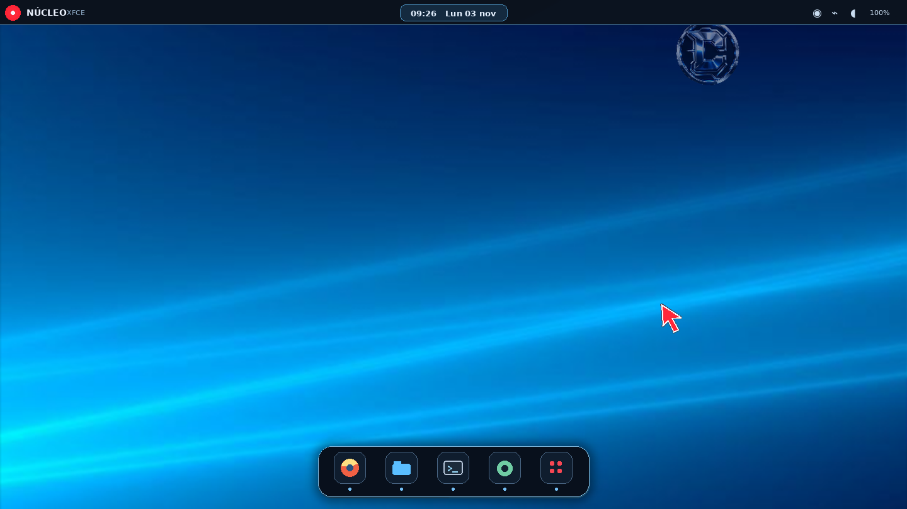

<div align="center">
  
  <h1>DC-LINUX OS · Núcleo Linux 1.0</h1>
  <p>Una edición Live ligera basada en Debian 13 (Trixie), con escritorio XFCE.</p>

  <p>
    <a href="https://github.com/DebianS4/DC-LINUXOS/releases/tag/nucleo-2026-11-04"></a>
    
    
    
  </p>
  <p>
    <a href="https://github.com/DebianS4/DC-LINUXOS"></a>
  </p>
</div>

## El escritorio



Núcleo Linux es una imagen Live híbrida para equipos **amd64 (x86_64)**. Puede arrancar en **BIOS y UEFI** y ofrece una sesión XFCE sencilla, con navegador Firefox ESR, NetworkManager, firmware y las herramientas básicas del escritorio.

El tema visual incluye el fondo de Núcleo y el cursor **DC-Red-Luminous**.

## Descargar Núcleo Linux 1.0

[**Ir a la release y descargar la ISO**](https://github.com/DebianS4/DC-LINUXOS/releases/tag/nucleo-2026-11-04)

GitHub Releases distribuye la ISO en dos partes. Descarga los dos archivos `.part00` y `.part01`, además del archivo `.sha256`, y colócalos en la misma carpeta.

En Linux o macOS, reconstruye la imagen y comprueba su integridad:

```sh
cat live-image-amd64.hybrid.iso.part00 live-image-amd64.hybrid.iso.part01 > live-image-amd64.hybrid.iso
sha256sum -c live-image-amd64.hybrid.iso.sha256
```

En Windows, desde Símbolo del sistema:

```bat
copy /b live-image-amd64.hybrid.iso.part00+live-image-amd64.hybrid.iso.part01 live-image-amd64.hybrid.iso
```

SHA-256 publicado para la ISO reconstruida:

```text
94e3e87f82210501c812ad7a3b062ff6620eee5e56c07cdf192542463b9d9e47
```

## Compilar desde el código fuente

Compila en Debian o Ubuntu con conexión a Internet y al menos **25 GB de espacio libre**. Se requiere `live-build` `1:20250505+deb13u1` o posterior, `debootstrap`, `xorriso`, `squashfs-tools`, `dosfstools`, `mtools`, `grub-pc-bin`, `grub-efi-amd64-bin` y un llavero de Debian que incluya las claves de Trixie. El proceso utiliza `sudo`.

Desde la raíz del repositorio, ejecuta:

```sh
./build.sh
```

El script limpia artefactos anteriores, restaura la configuración de `live-build` y genera el ISO híbrido junto con el manifiesto y las sumas SHA-256. La primera compilación descarga paquetes de Debian y puede tardar según la conexión.

## Verificación antes de instalar

La compilación puede fallar en CI o contenedores que bloqueen montajes, espacios de nombres o `chroot`. Antes de usar o distribuir la imagen, pruébala en una máquina virtual y comprueba red, Wi-Fi, audio, gráficos e instalación en hardware real.

## Enlaces

- [Repositorio del proyecto](https://github.com/DebianS4/DC-LINUXOS)
- [Release Núcleo Linux 1.0](https://github.com/DebianS4/DC-LINUXOS/releases/tag/nucleo-2026-11-04)
